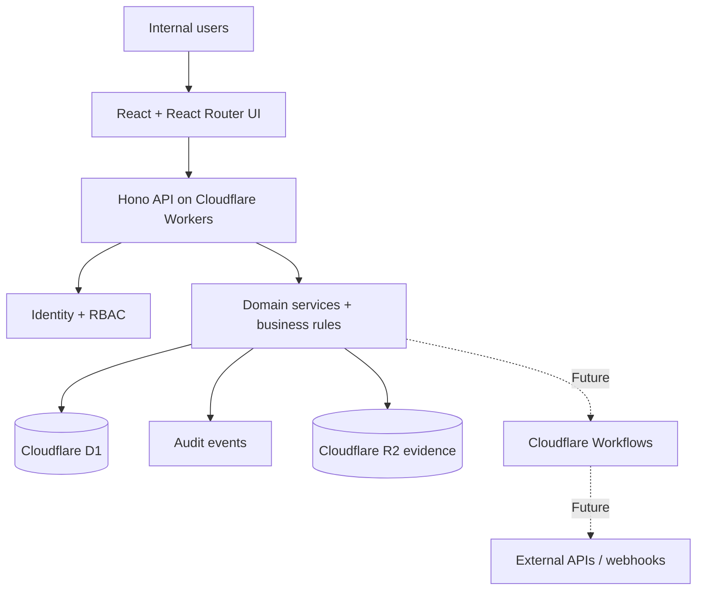

# BPMS Enterprise — Internal Operations Platform

> **Status:** governance starter + imported Cloudflare scaffold (phase C bootstrap; see `docs/architecture/SCAFFOLD-PROVENANCE.md`).
>
> **Category:** Enterprise Application Software (EAS) / Business Process Management System (BPMS).
>
> **Scope:** private internal business operations platform with web application, APIs, workflow automation, integrations, evidence management and auditability.

## 1. Purpose

Build an internal full-stack application that enables an organization to plan, execute, monitor and audit business activities. Reuse a maintained, official Cloudflare application template. Do **not** implement existing framework capabilities from scratch.

**First vertical slice:** list an activity, view its details, change its status according to an explicit transition policy, attach evidence and recalculate the parent progress. Authenticate the user, enforce authorization on the server, write an audit event and test the entire journey.

> BPMN 2.0 modelling/execution is **not included** in the Cloudflare template. Cloudflare Workflows handles durable orchestration, but does not make the application BPMN-conformant. A standards-compliant BPMN runtime (e.g. Flowable) requires a separate decision and infrastructure if requested by the client.

## 2. Selected stack

| Layer | Standard | State |
| --- | --- | --- |
| Language | TypeScript, strict mode | Template / enforce |
| Web | React + React Router (template's current compatible version) | Template |
| UI | Tailwind CSS + shadcn/ui components | Template; verify actual components |
| Build | Vite + Cloudflare Vite plugin | Template |
| API | Hono, REST under `/api` | Template |
| API contracts | Zod + `@hono/zod-openapi` | To integrate |
| Runtime/hosting | Cloudflare Workers + Wrangler | Template |
| Database | Cloudflare D1 (SQLite) | To provision |
| ORM/migrations | Drizzle ORM + drizzle-kit + Wrangler D1 migrations | To integrate |
| Authentication | Better Auth + Drizzle adapter, invite-only access | Candidate; runtime compatibility gate |
| Authorization | Application RBAC + resource-level checks | To implement |
| File storage | Cloudflare R2 | To provision |
| Durable jobs | Cloudflare Workflows | Later phase |
| External integrations | Typed API adapters + webhook verification + retries | Later phase |
| Unit/integration tests | Vitest + `@cloudflare/vitest-plugin` | To integrate |
| Browser E2E tests | Playwright | To integrate |
| Quality | TypeScript, Biome or ESLint (one only), dependency audit | To integrate |
| Git / CI | GitHub + GitHub Actions | To configure |
| Architecture docs | arc42 + C4 views + ADRs | Governance files |

**Package manager:** npm (preserve the upstream `package-lock.json`). **Initial deployment unit:** one Worker serving the SPA and `/api`. Add separate workers/services only after an Architecture Decision Record (ADR).

## 3. Architecture (logical)



**Architectural rule:** keep domain rules in `workers/modules/` (or the closest template-compatible server path). Keep API routes thin. Never depend on browser-side role checks for security. Do not split into multiple deployment units until necessary.

## 4. Expected repository structure

```text
bpms-enterprise/
├── README.md                             # You are here; protected
├── CLAUDE.md                             # Claude Code implementation contract
├── .gitignore
├── docs/
│   ├── architecture/
│   │   ├── ADR-0001-cloudflare-stack.md
│   │   ├── REPOSITORY-ARCHITECTURE.md
│   │   └── SCAFFOLD-PROVENANCE.md        # Generated by importer
│   ├── implementation/
│   │   └── SCAFFOLD-IMPORT.md
│   └── quality/
│       └── ACCEPTANCE-GATES.md
├── scripts/
│   └── import_scaffold.py                # Safe, non-overwriting importer
├── .github/
│   └── PULL_REQUEST_TEMPLATE.md
│
│  # Added from the official template after import:
├── app/                                  # React routes, feature UI, reusable components
├── workers/                              # Hono API + future domain services
├── public/
├── package.json
├── package-lock.json
├── react-router.config.ts
├── vite.config.ts
├── wrangler.jsonc
└── tsconfig*.json

# Later, create only when needed:
# workers/modules/{activities,processes,identity,audit,integrations}/
# workers/db/{schema,migrations}/
# app/features/{activities,processes,dashboard}/
# shared/contracts/
# tests/{integration,e2e}/
```

Do not pre-create files that conflict with the official template. Review the imported source before adding modules. This layout is a **single repository / modular monolith**, not an empty multi-app monorepo.

## 5. Bootstrap: first run for Claude Code

**Prerequisites:** Git, Node.js version supported by current Wrangler, npm and Python 3.9+. The GitHub repository is cloned locally and the governance files have been committed.

```bash
# From the repository root: inspect first, without writing
python3 scripts/import_scaffold.py --dry-run

# Import only after confirming the repository is clean
python3 scripts/import_scaffold.py --apply

# Install exactly the versions in the official template lockfile
npm ci

# Verify available template scripts
npm run typecheck
npm run build

# Run locally
npm run dev
```

**Never paste this command into an existing application directory before reviewing the import report.** The importer rejects file collisions, protects this README and records upstream commit provenance. It does not provision Cloudflare resources or deploy.

See [Scaffold import runbook](docs/implementation/SCAFFOLD-IMPORT.md) for follow-up phases, installed vs planned components and approval rules.

## 6. Implementation phases and gates

| Phase | Deliverable | Acceptance gate |
| --- | --- | --- |
| A — Discover | approved process, roles, data and requirements | client validates the process |
| B — Design | architecture and ADRs | dependencies and risks recorded |
| C — Bootstrap | official source imported; local build works | `npm ci`, typecheck, build pass |
| D — Foundation | D1, schema, authentication, authorization, audit | isolated user permissions tested |
| E — Vertical slice | activity → state transition → evidence → progress | verified end-to-end |
| F — Integrations | external APIs/workflows with retries and idempotency | failures and replays tested |
| G — Release | CI, staging, observability, backups, recovery | release gates passed |

Each phase must produce tested, committed results. No production deployment is authorized by the presence of this README.

## 7. Security and operations contract

- All protected endpoints **MUST** authenticate and authorize on the server for the relevant object.
- Public self-registration **MUST** be disabled unless explicitly approved.
- Every business state change **MUST** produce an immutable-in-application audit record with actor, action, target, timestamp and correlation ID.
- Every external side effect **MUST** have an idempotency plan, timeout policy and explicit failure handling.
- Uploaded files **MUST** be private by default. Validate file type, size, access and retention.
- Secrets **MUST NOT** be committed. Use local `.dev.vars` and Cloudflare secrets for deployed environments.
- Database migration and rollback plans **MUST** be reviewed before production changes.
- Development, staging and production **MUST** use separate data and configuration.
- Dependency updates **SHOULD** be scoped and verified, not bundled with structural refactoring.
- Authentication and workflow execution choices **MUST** pass runtime compatibility checks before implementation is considered complete.

Follow [Acceptance Gates](docs/quality/ACCEPTANCE-GATES.md).

## 8. References and provenance

- Official full-stack scaffold: https://github.com/cloudflare/react-router-hono-fullstack-template
- Cloudflare Workers + Hono: https://developers.cloudflare.com/workers/framework-guides/web-apps/more-web-frameworks/hono/
- Cloudflare D1: https://developers.cloudflare.com/d1/get-started/
- Drizzle + D1: https://orm.drizzle.team/docs/sqlite/connect-cloudflare-d1
- Hono Zod OpenAPI: https://hono.dev/examples/zod-openapi
- Workers Vitest integration: https://developers.cloudflare.com/workers/testing/vitest-integration/
- Cloudflare Workflows: https://developers.cloudflare.com/workflows/get-started/guide/
- BPMN standard: https://www.omg.org/spec/BPMN/
- arc42: https://arc42.org/overview/
- NIST SSDF: https://csrc.nist.gov/pubs/sp/800/218/final
- OWASP ASVS: https://owasp.org/www-project-application-security-verification-standard/

**Licensing:** keep upstream copyright notices and license terms, and verify each imported dependency and scaffold license before commercial release.
