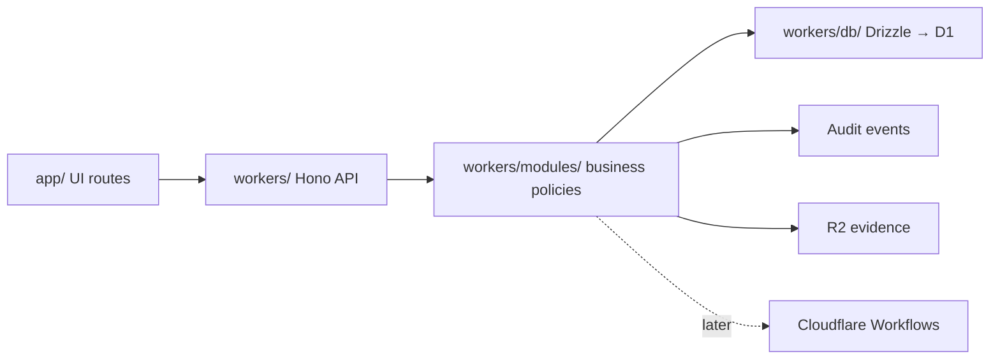

# Repository architecture and module boundaries

## Macro: one repository, one initial deploy unit

The official template has top-level `app/`, `workers/`, `public/`, `vite.config.ts`, `react-router.config.ts`, `wrangler.jsonc` and `package.json`. Do not move these into `apps/web` or `apps/api` as part of the initial import.



## Meso: feature-oriented module proposal

```text
app/
  features/
    activities/
    dashboard/
    processes/
  components/
  routes/                       # Keep current template naming/routing conventions
workers/
  modules/
    activities/                 # service, policy, repository adapter
    processes/                  # process state and transition policy
    audit/                      # append-only event writer
    identity/                   # authorization services
    evidence/                   # private R2 access
    integrations/               # external service adapters
  db/
    schema.ts                   # Drizzle schema, once implemented
shared/
  contracts/                    # optional shared OpenAPI/Zod exports
```

**Do not create all modules just for their names.** Add modules when the corresponding use case begins.

## Micro: request lifecycle

1. Browser calls `/api/activities/{id}` with an authenticated session.
2. Hono authenticates and verifies the user's access to the specific activity and organization.
3. Zod validates parameters and request body.
4. Domain policy checks allowed state transition and computes the new aggregate progress.
5. Repository writes state and audit data atomically when supported; document compensating steps for nontransactional side effects.
6. Handler returns an OpenAPI-conformant response.
7. E2E verifies the result; integration test verifies forbidden access and rollback/duplicate behavior.

## Module rules

- No direct D1 queries inside React components.
- Avoid SQL inside API handlers; hide persistence behind repositories.
- A UI permission flag cannot replace API authorization.
- Keep DTO schemas consistent with OpenAPI definitions; no manually duplicated types.
- Use UTC timestamps in persistence, locale formatting only in UI.
- Each data row MUST have an ownership/scope key appropriate to the client organization. Cross-scope fetches MUST fail closed.
- Audit events MUST contain actor, resource, old/new state (where appropriate), action, timestamp, correlation ID and result.
- Private evidence download MUST be authorized before retrieving R2 objects.

## Practical boundaries for first release

In scope: authentication, roles, activities, progress, evidence, audit, dashboard, basic API.

Out of scope until separately approved: multi-tenant SaaS signup, process designer, BPMN XML runtime, service mesh, event-sourcing rewrite, real-time collaboration, arbitrary-code user automation.

## Extension decision thresholds

Write an ADR before moving to PostgreSQL, adding a BPMN engine or creating multiple Workers. Include business requirement, operational cost, data residency, failure modes, incremental migration and a tested rollback approach.
